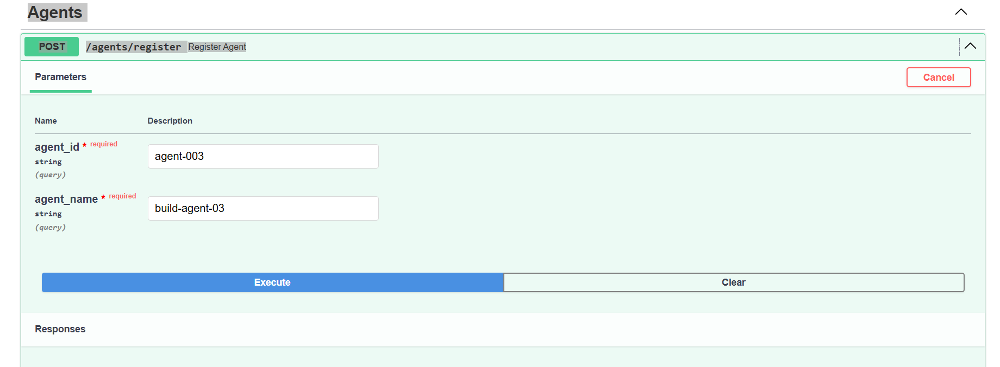
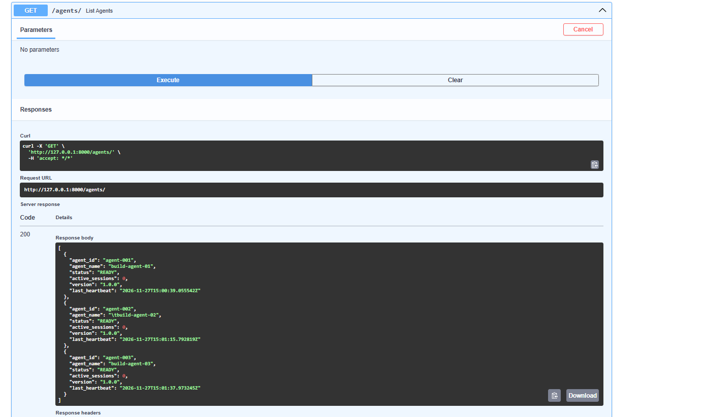

run
http://127.0.0.1:8000/docs

now next register the agents

POST/agents/register
Register Agent  ---> try-out

| Agent ID | Agent Name |
|---|---|
| agent-001 | build-agent-01 |
| agent-002 | build-agent-02 |
| agent-003 | build-agent-03 |

GET
/agents/
List Agents ---> exceute 

